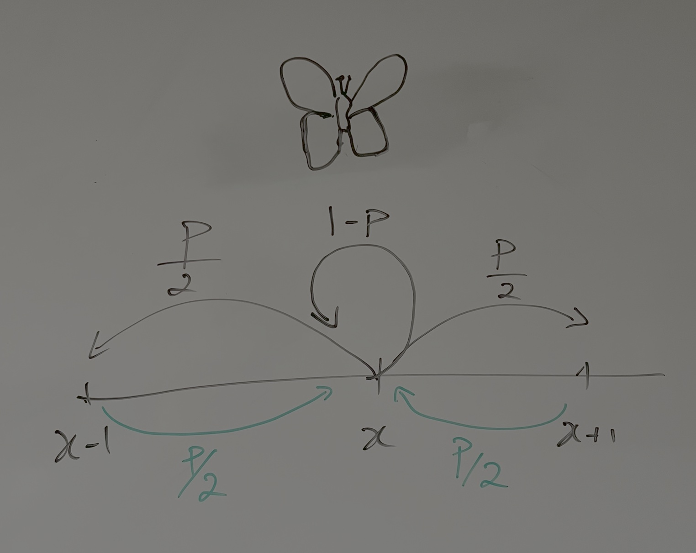

---
execute:
  freeze: auto  # re-render only when source changes
---

> 🚧 **This chapter is under construction. Content may change.**

# Movement and dispersal**:** should I stay or should I go?

All animals move, at least at a given stage of they life. Animals can move to find food, mates or just a new territory to settle. Some animals even move across continents to track the seasonal changes in resources. A particularly important type of movement is natal dispersal, this is how animals disperse from their birth place to the place where they reproduce. Dispersal also occurs in plants when seeds are transported by wind or by animals. Some movement may be directional, for instance fish following a river or ocean current, while other movements may seem more random.

## The random-walk

One may ask how animals take decisions on where to move and how this influences their distribution over time. One simple but yet effective model is the random-walk model. It assumes that individuals at each moment take a step in a random direction. The question is then, where will the individual be after a certain amount of time? Let's start with a simple random-walk in one dimension. Consider that the initial position of an individual at time $t=0$ is $x=0$ and that it can either move a step to the right or a step to the left with probability $p$, while the probability of staying still is $q=1-p$.



We keep track of how many individuals with are at each position x at time t with the function n(t,x). It's easy to see that the number of individuals at position x at time t+1 is the number of individuals that stayed still, plus the individuals that came from the left plus the individuals that came from the right, this is,

$$
n(x,t+1)=n(x,t)q+n(x-1,t)p/2+n(x+1,t)p/2
$$ {#eq-rw1}

Diffusion dispersal models as random-walk. Relationship with normal distribution.

$$
\sigma^2 = 2\ D\ t
$$

```{r}
library(Ryacas)

n = ysym(
  "Exp(-x^2/(4*D*t))/Sqrt(4*pi*D*t)"
)

dn_dt = deriv(n,"t")
dn_dt
d2n_dx2 = deriv(deriv(n, "x"), "x")
d2n_dx2

residual = simplify(dn_dt - ysym("D") * d2n_dx2)
simplify(simplify(residual))
```

## Habitat selection

Interactions between neighbor individuals (e.g. competition for space or resources).

### Ideal free distribution

### Ideal despotic distribution
